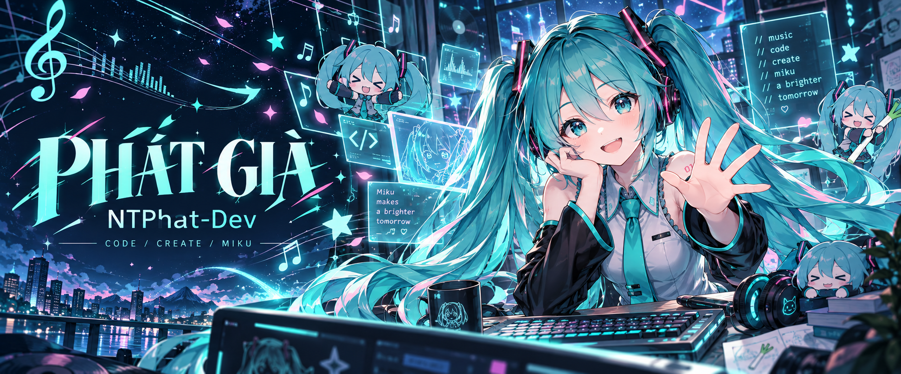
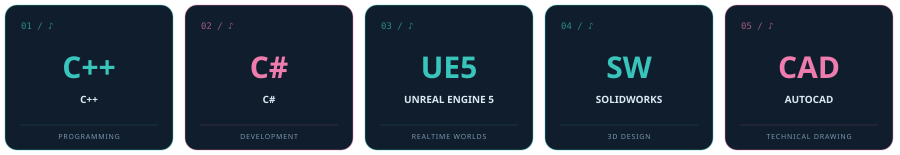

## 🎧 こんにちは! Mình là Phát Già.

**Nguyễn Tấn Phát · Code, create & a little Miku magic.**

 

<table>
<tr>
<td width="62%" valign="middle">

### 🩵 A little about me / はじめまして

Mình thích kết nối **lập trình**, **thế giới 3D** và **thiết kế kỹ thuật** — từ một dòng code đến một thứ có hình hài.

- 💻 Lập trình với **C++** và **C#**.
- 🌌 Khám phá trải nghiệm realtime với **Unreal Engine 5**.
- ⚙️ Thiết kế bằng **SolidWorks** và **AutoCAD**.
- 🎨 Góc GitHub này dành trọn sắc xanh ngọc cho **Hatsune Miku**.

**「Code with curiosity. Create with imagination.」**

</td>
<td width="38%" align="center" valign="middle">

 
✦ MIKU MODE: ALWAYS ON ✦
</td>
</tr>
</table>

### 🎹 My creative toolkit / つくるための道具

 

### 🌐 Step into my world / 僕の世界へ

  

**Let's turn an idea into the next build.**

📬 [ntphat.dev@gmail.com](mailto:ntphat.dev@gmail.com) · 🌐 [Portfolio](https://ntphat-dev.github.io/) · 🩵 [Facebook](https://www.facebook.com/whr98239r82w3hhfewu/)

 

Hatsune Miku fan theme · Custom AI-generated artwork · Made for NTPhat-Dev

